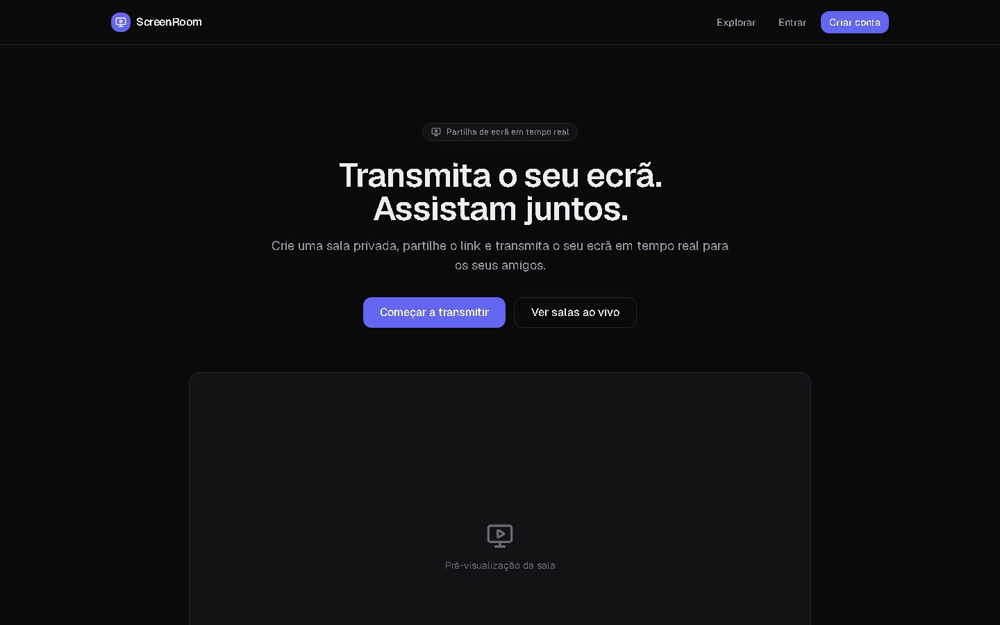
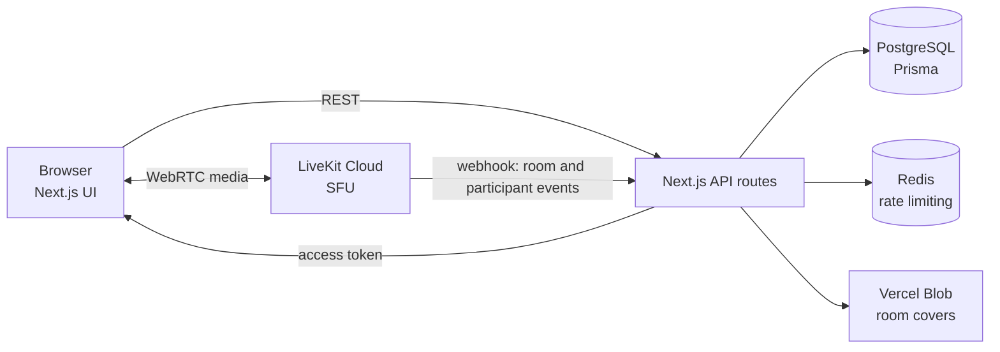

# ScreenRoom

[](https://github.com/anderson-fullstack-developer/app_screm/actions/workflows/ci.yml)


**Real-time screen sharing in private rooms.** Create a room, share the invite link and stream your screen to the people you let in, with full control over who watches.

**Live demo:** [app-screm.vercel.app](https://app-screm.vercel.app)



## Features

- **Rooms:** create private or public rooms, with an optional password and a cover image.
- **Invites:** unique invite links that can be revoked at any time.
- **Real-time screen sharing** over WebRTC, through a LiveKit SFU.
- **Host controls:** lock the room, remove or ban participants and end the session for everyone.
- **Room chat** stored with the room.
- **Live status:** a LiveKit webhook keeps each room's status in sync with what is really happening in the media server.
- **Admin panel:** rooms (reopen, purge ended rooms), users with sign-up method and activity, and global settings.
- **Authentication:** email and password, plus Google sign-in when it is configured.

## Architecture



- **Media never touches the app server.** The API checks the user's permissions and issues a short-lived LiveKit token; the video goes straight from the browser to LiveKit.
- **Authorisation on the server:** every room action goes through one permission layer (`src/lib/permissions`) that decides what the host, a member, a guest and an admin can do.
- **Validation with Zod** on every request body, with consistent error responses.
- **Audit log** of sign-ups, room joins and leaves, and room status changes, written without ever blocking the request.

## Security

- Passwords hashed with **Argon2id**; HTTP-only, `SameSite=Lax` session cookies with secure prefixes in production.
- Brute-force protection per IP and per email, and rate limiting backed by Redis.
- Security headers and a Content Security Policy.
- Signature check on the LiveKit webhook.

Details in [SECURITY.md](SECURITY.md).

## Tech stack

| Area | Technologies |
|---|---|
| Front-end | Next.js 16 (App Router), React 19, TypeScript, Tailwind CSS |
| Back-end | Next.js route handlers, Prisma, PostgreSQL (Neon), Zod, Pino |
| Real time | WebRTC, LiveKit (client and server SDKs) |
| Auth and security | Auth.js v5, Argon2id, Redis (ioredis) |
| Storage | Vercel Blob |
| Quality | Vitest, Playwright, ESLint, GitHub Actions |
| Deploy | Vercel and LiveKit Cloud; Docker Compose for local LiveKit and Redis |

## Getting started

Requirements: Node.js 20.9+, Docker and a PostgreSQL database (local or Neon).

```bash
npm install
cp .env.example .env        # database, Auth.js secret, LiveKit keys, Redis
docker compose up -d        # local LiveKit server and Redis
npm run db:migrate
npm run dev                 # http://localhost:3000
```

Deploying to Vercel is described in [docs/DEPLOY.md](docs/DEPLOY.md).

## Tests

52 automated tests:

- **Unit (Vitest):** permissions, request schemas, security helpers, rate limiting, the LiveKit webhook, settings and utilities.
- **End-to-end (Playwright):** sign-up and sign-in, room flows and the admin area.

```bash
npm run typecheck
npm run lint
npm run test        # unit
npm run test:e2e    # end-to-end
```

GitHub Actions runs type checking, lint and unit tests on every push.

## Author

**Anderson Neto**, Full-Stack Developer in Lisbon. [Portfolio](https://andersonneto.gt.tc) · [LinkedIn](https://linkedin.com/in/anderson-fullstack-developer)

## License

[MIT](LICENSE)
